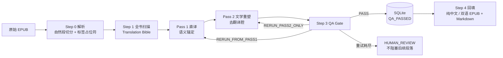

# BookCraft-LLM（Rust）

[](https://github.com/a5ynchr0ny/BookCraft-LLM-rs/actions/workflows/ci.yml)

面向百万字级长文本的**多 Agent 文学精译与自动化质检管线**，Rust 重写版。

把一本原始 EPUB，自动变成**纯中文精译版**与**双语对照版**电子书：全书级《翻译圣经》锁定术语与人物声口，双阶段翻译分离「忠实」与「文学性」，三级 QA 门禁拦截漏译/幻觉/翻译腔，SQLite 状态机支持断点续传与局部重跑。

> 与 Python 参考实现功能对齐：EPUB 无损解析/回填、翻译圣经、Aho-Corasick 实体挂载、双步翻译、三级 QA、OpenAI/Anthropic/Gemini/Mock 四类客户端、CLI、断点续传与成本台账。`settings.yaml` 中的模型 ID 是占位值，需按账号实际可用模型替换。

---

## 为什么不是「一次 Prompt 翻全书」

| 单次翻译的典型问题 | 本项目的机制 |
| --- | --- |
| 人名/地名跨章节漂移（包法利 → 博瓦里） | Step 1 生成全局《翻译圣经》，Aho-Corasick 别名匹配 + 黑名单漂移拦截 |
| 代词指代断裂、上下文不接 | 章内滑动窗口：前 2 段终稿译文 + 后 1 段原文 |
| 长难句生硬、满纸翻译腔 | Pass 1 直译打底 → Pass 2 文学重塑，职责解耦 |
| 模型偷懒漏译 / 复读幻觉 | 字符膨胀率熔断 + LLM-as-a-Judge 盲审 |
| 长书跑一半失败、无法续跑 | SQLite 段落级状态机，每阶段落库，断点续传 |
| EPUB 重打包后 XML 损坏 | 行内标签占位符协议 + 直接 zip 级回填，不改 manifest |

## 架构



**两级并发**：章间用 `tokio::sync` + `buffer_unordered(chapter_workers)` 并行；章内严格顺序，保证第 N 段能用第 N-1/N-2 段终稿译文做上下文。既保住文气衔接，又避免整本书串行十几小时。

**Prompt 成本**：`System Prompt + 全书文风指南 + Top-N 核心角色` 作为静态前缀放在最前面，命中 Anthropic / OpenAI / Gemini 的上下文缓存；动态实体与滑动窗口放在消息末尾。

## 目录结构

```text
BookCraft-LLM-rs/
├── Cargo.toml
├── config/
│   ├── settings.yaml          # 模型路由、并发、QA 阈值、成本单价
│   └── prompts/               # 4 套核心 Prompt（.j2）
├── src/
│   ├── main.rs                # clap CLI
│   ├── lib.rs
│   ├── config.rs              # 配置加载 + .env
│   ├── models.rs              # 圣经 / 阶段产物 / Judge Schema
│   ├── tags.rs                # 行内标签占位符协议
│   ├── html.rs                # html5ever DOM + XHTML 序列化器
│   ├── epub_io.rs             # EPUB zip 级无损读写
│   ├── epub_parser.rs         # OPF/NCX/spine、自然段切分
│   ├── state.rs               # SQLite 状态机 / 成本台账
│   ├── prompts.rs             # minijinja 模板渲染
│   ├── llm/mod.rs             # 4 类模型客户端 + 结构化校验
│   ├── entity_matcher.rs      # Aho-Corasick 别名检索
│   ├── qa_gate.rs             # 三级 QA 门禁
│   ├── bible_builder.rs       # Step 1
│   ├── translator.rs          # Step 2/3 调度
│   ├── epub_builder.rs        # Step 4 导出
│   ├── sample.rs              # 合成示例书
│   └── bin/make_sample.rs
├── tests/
│   ├── tags.rs
│   ├── entity_matcher.rs
│   ├── qa_gate.rs
│   ├── reflection.rs          # 反思重试 / 熔断 / 断点续传
│   └── e2e.rs                 # CLI 全链路 + EPUB 校验
└── .github/workflows/ci.yml
```

## 快速开始（无需 API Key）

要求 Rust 1.85+。

```bash
cargo build --release

# 生成一本 2 章的法语合成 EPUB
cargo run --release --bin make_sample -- /tmp/sample.epub

# mock 模式跑通「解析 → 圣经 → 双步翻译 → QA → 导出」
cargo run --release --bin bookcraft -- \
  --workdir /tmp/bookcraft-demo --mock run /tmp/sample.epub

ls /tmp/bookcraft-demo/output/
```

产出：

```text
/tmp/bookcraft-demo/output/
├── <书名>.zh.epub          # 纯中文精译版
├── <书名>.bilingual.epub   # 双语对照版
├── <书名>.zh.md
├── <书名>.bilingual.md
└── qa_report.md            # 状态分布 / 分阶段成本 / 人工复核清单
```

> `--mock` 会把四条模型路由切到离线 MockProvider，译文是占位中文，仅用于验证工程链路，**不是真实翻译结果**。

也可以安装成全局命令：

```bash
cargo install --path .
bookcraft --workdir /tmp/bookcraft-demo --mock run /tmp/sample.epub
```

## 接入真实模型

Key 有两种填法（任选其一，shell 环境变量优先）：

```bash
# 方式 A：项目根目录 .env（推荐，已加入 .gitignore）
cp .env.example .env
# 编辑 .env，填入 GEMINI_API_KEY / ANTHROPIC_API_KEY / OPENAI_API_KEY / DEEPSEEK_API_KEY

# 方式 B：直接 export
export GEMINI_API_KEY=...
export ANTHROPIC_API_KEY=...
export OPENAI_API_KEY=...
export DEEPSEEK_API_KEY=...
```

启动时自动加载 `.env`，但**不会覆盖** shell 中已存在的同名变量。变量名由 `config/settings.yaml` 中 `providers.*.api_key_env` 决定。

编辑 `config/settings.yaml`，把 `models.*.model` 换成账号实际可用的模型 ID：

```yaml
models:
  bible:  { provider: gemini,    model: <gemini-model>,   temperature: 0.2 }
  pass1:  { provider: deepseek,  model: <deepseek-model>, temperature: 0.1 }
  pass2:  { provider: anthropic, model: <claude-model>,   temperature: 0.7 }
  judge:  { provider: openai,    model: <judge-model>,    temperature: 0.0 }
```

```bash
bookcraft prepare book.epub        # Step 0
bookcraft bible                    # Step 1
bookcraft translate                # Step 2 + 3
bookcraft export                   # Step 4
bookcraft status                   # 进度 / 成本 / 待复核
```

也可以一条命令：

```bash
bookcraft run book.epub
```

### CLI 参数

| 命令 | 说明 |
| --- | --- |
| `prepare <epub>` | 解析并切段；`--force` 重解析（清空翻译进度） |
| `bible [--force]` | 生成/重建《翻译圣经》 |
| `translate [--chapters 1-3,7] [--limit N] [--retry-human]` | 按章过滤、限量压测、连人工复核段落一起重试 |
| `export` | 导出 EPUB / Markdown / QA 报告 |
| `status` | 章节进度、失败段落、成本 |
| `run [epub]` | prepare → bible → translate → export |

全局参数：`--config`、`--workdir`、`--mock`、`-v`。

## 核心设计细节

### 行内标签无损协议

```html
<p>Il dit <i>bonjour</i> à M<sup>me</sup> Arnoux.<a href="#n1">[1]</a></p>
```

```text
source_text = "Il dit [tag_1]bonjour[/tag_1] à M[tag_2]me[/tag_2] Arnoux.[tag_3][1][/tag_3]"
tag_map     = {"tag_1": {"open": "<i>", "close": "</i>"}, ...}
```

- 空元素（`<br/>`、``）使用 `[tag_x/]`；
- 模型只搬运占位符，不允许改写编号；
- Level 1 校验「每个 tag 的开/闭/自闭合数量 + 嵌套合法性」，不强制顺序（中文语序可能调整强调块位置）；
- 导出时按 `tag_map` 还原原始属性，并统一做 HTML 转义，避免译文里的 `&`/`<` 破坏 XML。

导出不经过 ebooklib 式的 HTML 重建，而是**直接替换 EPUB zip 里的正文条目**，因此 CSS、图片、字体、manifest、spine 全部原样保留，`mimetype` 仍是第一个且不压缩的条目。

### QA Gate 三级机制

1. **Level 1 确定性校验（0 成本）**
   - 占位符完整性；
   - 术语黑名单：原文命中实体时，译文不得出现 `forbidden_variants`；
   - 首现检查：实体在**本章首次出现**必须用标准译名，后续允许合理省译为代词；
   - 字符膨胀率：`译文汉字数 / 原文词数`，正常 `[1.1, 2.4]`，对白放宽到 `[0.7, 3.5]`；过短判 `OMISSION`，过长判 `LENGTH_ANOMALY`；
   - 长度比只在中译目标 + 非 CJK 源文时启用，短段落（<3 词）跳过以免噪声。
2. **Level 2 Judge 盲审**：轻量模型按 1~5 分评估完整性、准确性、术语合规、汉语流畅度。
3. **Level 3 路由与熔断**：
   - `TAG_ERROR / TRANSLATIONESE / GLOSSARY_DRIFT / VOICE_MISMATCH` → 只重跑 Pass 2；
   - `OMISSION / MISTRANSLATION / LENGTH_ANOMALY` → 回退重跑 Pass 1 + Pass 2；
   - 最多重试 `qa.max_retry` 次，仍不过 → 保留历史最高分版本，标 `HUMAN_REVIEW`，继续后面的段落；
   - Judge 自身超时/限流/连续 JSON 失败时 **fail-open**，记录 `judge_skipped_reason`，不让基础设施故障卡死整本书。

### 状态机与断点续传

```text
PENDING → DRAFTED → POLISHED → QA_PASSED
                      ↘ QA_FAILED → (重试) DRAFTED / POLISHED
                                   ↘ HUMAN_REVIEW
```

每个阶段完成即写库；`translate` 重跑时：

- `QA_PASSED` 直接跳过；
- `DRAFTED` 复用 Pass 1 直译稿；
- `POLISHED` 直接补跑 QA；
- `QA_FAILED` 按 `last_routing` 从最近检查点继续。

`qa_reports` 记录每次尝试的分数/路由/问题，`cost_ledger` 按 `stage/provider/model/token` 记账，`status` 与 `qa_report.md` 直接汇总。

### 并发与成本

- 章间并发、章内串行；
- Pass 1 与 Pass 2 使用同一套滑动窗口上下文，减少重复输入；
- Prompt 静态前缀前置以命中缓存（Anthropic 系统块已带 `cache_control: ephemeral`）；
- `pricing` 按 `provider/model` 配置 USD / 百万 token，支持缓存输入单价；mock 模式成本为 0。

## 测试与质量

```bash
cargo test                     # 35 个测试
cargo clippy --all-targets -- -D warnings
cargo fmt --check
```

覆盖：

- 标签协议：解析、计数、嵌套校验、HTML 转义、未知占位符；
- 实体匹配：大小写、词边界、连字符复合词、最长匹配、频次排序、空圣经；
- QA Level 1：标签错误、漏译、膨胀、黑名单、首现、短段豁免；
- 反思循环：只重跑 Pass 2、回退 Pass 1、重试耗尽转人工、已通过段落不重复处理；
- 端到端：`prepare → bible → translate(--limit) → 续跑 → export`，校验产物 XML 合法、无残留占位符、`<i>/<sup>/<a>` 保留、双语样式与 OPF 元数据正确。

## 已知限制 / Roadmap

- `settings.yaml` 的模型 ID 是占位值；不同供应商的参数差异需按实际 API 调整；
- Prompt 目前针对**法语文学 → 中文**调校，其他语向需要改写风格指南与长度比阈值；
- 超长书的《翻译圣经》采用「按章预算首尾抽样」控制输入；可扩展为 map-reduce 分卷抽取再归并；
- 导出目前总是整本；未实现单章导出与「强制重译已通过章节」的参数；
- 导航页（nav.xhtml / NCX）不翻译，目录标题保持原文；每章首个标题会作为正文翻译；
- 暂未实现：限流令牌桶、全局预算硬熔断、Web UI、图片内文字 OCR；
- 请仅对**公版或已获授权**的文本使用本项目。

## License

MIT
